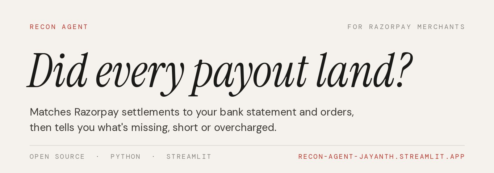
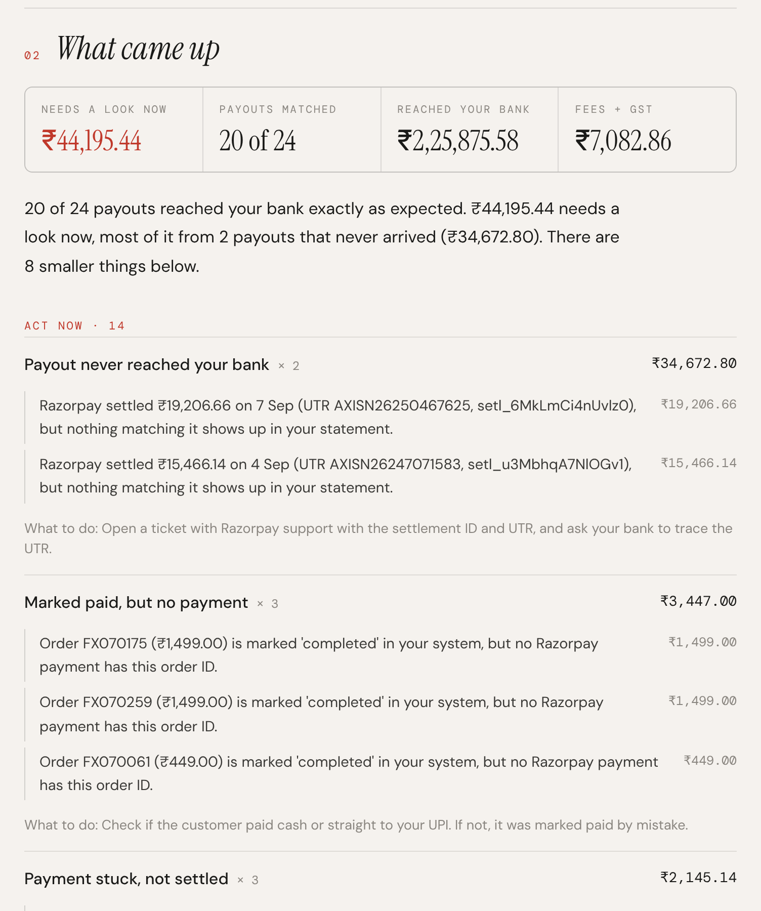

<p align="center"></p>

<p align="center">
  <a href="https://recon-agent-jayanth.streamlit.app"><b>Try it</b></a> &nbsp;·&nbsp;
  <a href="#how-it-works">How it works</a> &nbsp;·&nbsp;
  <a href="#how-well-it-works">How well it works</a> &nbsp;·&nbsp;
  <a href="#run-it-yourself">Run it yourself</a>
</p>

If you sell on Razorpay, the money doesn't arrive when the customer pays. It comes a couple of days
later, one lump per day, with the fee and GST taken out and refunds netted off. Someone is supposed
to check that each of those lumps actually reached the bank, and in full.

In most small businesses that someone does it in Excel, if at all. Every bank exports its statement
differently. Narrations get cut off before the UTR. A day with a lot of refunds pays nothing and
quietly shrinks the next payout. A missing ₹15,000 can sit unnoticed between a hundred UPI debits.

Recon Agent does that check. You give it the Razorpay settlement report, your bank statement for the
same dates and, if you have it, your own orders export. It gives back a short list of what's wrong,
biggest money first, with what to do about each one.



## What it looks for

- Payouts Razorpay says it sent that never reached your bank
- Payouts that arrived short, or now and then higher than expected
- Payments captured but still not settled days later
- Fees above your plan's rate, and GST that isn't 18% of the fee
- Customers charged twice for the same order
- Cancelled orders where nobody refunded the money
- Orders marked paid in your system with no payment behind them, and payments with no order
- Razorpay money in your bank that isn't in the report at all

## How it works

**Reading the files.** Bank statements are a mess: different column names, title rows above the
header, amounts written as "1,23,456.00 Cr", newest first or oldest first. The reader first tries
matching column names against the common ones. If that doesn't work, say an unfamiliar bank or
headers in Hindi, it asks an LLM to look at the headers and a few rows and say which column is which.

Neither guess is trusted on its own. A mapping is only accepted if the previous balance plus each
row's amount equals that row's balance, all the way down. If debit and credit got swapped, the same
check catches it and flips them back.

**Matching payouts.** Each settlement is looked for in the bank statement by its UTR. If the bank cut
the narration short, it falls back to the exact amount within a few days. If that fails too, it pairs
the closest leftover amounts, so a payout that came in ₹500 short shows up as one short payout instead
of one missing payout plus one unexplained credit. When refunds are bigger than a day's sales, Razorpay
pays nothing that day and takes the difference from the next payout. That's handled too.

**The rest is plain rules.** Fees against your rate card, GST against the fee, settlement against
T+2, orders against payments.

**Where the AI stops.** The LLM reads file layouts and can rewrite the summary in friendlier words.
It never calculates anything. If its summary has a number that isn't in the computed results, the
summary is thrown away and a plain template is used instead.

## How well it works

I don't have real merchant data yet, so this is tested on synthetic months. Each month has about 320
orders with 22 problems planted in it, run against three different bank layouts, over 30 months.

| | Precision | Recall |
|---|---|---|
| Clean data | 100% | 100% |
| Messy data: payouts posted up to 3 days late, 30% of narrations cut off | 95.9% | 99.2% |

Take the clean number with a pinch of salt, since I wrote both the generator and the checker. The
messy number is the honest one. It started at 89.3% and 97.0%, and reading through the false alarms
is what led to the late-posting window, the closest-amount pairing and the refund carry-forward. Most
of the false alarms left are payouts that land after the statement closes, and the app already marks
those as likely to show up in next month's statement.

The real test is real exports. That's the next step. Full tables are in [eval/RESULTS.md](eval/RESULTS.md).

## Run it yourself

```bash
git clone https://github.com/codeMaster60/recon-agent
cd recon-agent
pip install -r requirements.txt
streamlit run app.py
```

Click "Load a sample month" to try it without your own files. There's a command line version too:

```bash
python -m recon --report data/samples/settlement_report.csv \
                --bank data/samples/bank_format_b.xlsx \
                --orders data/samples/orders.csv --out out/
```

The AI step is optional. Without a key everything runs on rules, and all you lose is reading unusual
layouts like the Hindi sample. To turn it on, get a free key from [Groq](https://console.groq.com) and
set `GROQ_API_KEY`. Any OpenAI-compatible API works through `RECON_LLM_API_KEY`, `RECON_LLM_BASE_URL`
and `RECON_LLM_MODEL`.

The default fee rates (2% for everything) are placeholders. Put in your real plan in the app, or pass
`--rate-card rates.json` on the command line.

## Tests

```bash
pip install -r requirements-dev.txt
pytest --cov
```

122 tests, and the run fails if line or branch coverage drops below 100%. That includes the web app
itself, driven through Streamlit's test harness with real file uploads, and the HTTP client for the
LLM, which is tested against a small fake server so no key is needed.

Coverage only proves every line ran, so there's a second check. `python tests/mutation_check.py`
plants 20 realistic bugs one at a time, things like the wrong GST rate, dates read month-first,
refunds ignored in the double-charge check, or the AI allowed to invent numbers, and confirms the
tests catch every one. Writing that script turned up gaps that now have tests of their own.

CI runs all of it on Python 3.10, 3.12 and 3.13. Testing on more than one version found a real bug:
on pandas 2.x, a report column that was entirely blank came through as text and crashed the app.

## What's in here

```
app.py             the web app
recon/ingest.py    reading files, finding the header row, column mapping, the balance check
recon/engine.py    payout matching and every check
recon/report.py    the summary and the downloadable report
recon/look.py      the look shared by the app and the report
recon/llm.py       a small client for any OpenAI-compatible API, standard library only
data/generate.py   builds a synthetic month with known problems, in four bank layouts
eval/run_eval.py   precision and recall per problem type
tests/             unit, integration and app tests, plus the planted-bug check
```

## Not done yet

- It hasn't been run on real merchant exports. That's next.
- One settlement is matched to one bank credit. Banks that batch several payouts into one credit
  aren't handled.
- PDF statements aren't supported. Download CSV or Excel from net banking instead.
- Nothing is stored and there are no accounts, so there's no month-on-month history.

---

Made by [Sai Jayanth](https://www.linkedin.com/in/asaijayanth), with an AI pair programmer. The
typefaces are Instrument Serif, DM Sans and DM Mono, all under the SIL Open Font License; their
licences are in `static/fonts`.
