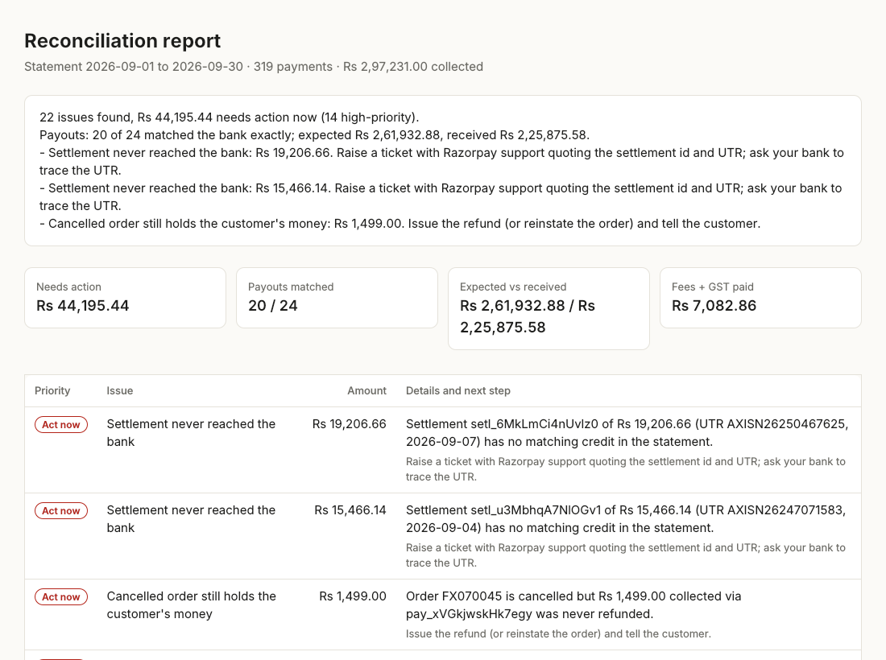

# Recon Agent

**Did every Razorpay payout actually reach my bank, in full, at the fees I agreed to?**

Small merchants answer that question by hand: export the settlement report, download the bank
statement, open both in Excel, and match rows by eye. Every bank's statement looks different,
narrations get cut off before the UTR, refunds are netted out of later payouts, and the one
missing ₹15,000 payout hides among a hundred UPI debits.

Recon Agent takes three exports and returns a short list of problems ranked by rupees at risk,
each with the next step to take.



## What it catches

| Problem | Why it matters |
|---|---|
| Payout never reached the bank | Money Razorpay says it paid, that you never received |
| Bank received less (or more) than the settlement | Unexplained deductions |
| Captured payment never settled | Stuck money past the T+2 cycle |
| Fee above your rate card, GST not 18% of fee | Overcharging; wrong GST input credit |
| Customer charged twice for one order | Refund before it becomes a chargeback |
| Cancelled order still holding the customer's money | Refund owed |
| Order marked paid with no payment / paid amount ≠ order value | Your books are wrong |
| Razorpay credit in the bank with no settlement | Wrong account or report period |

## How it works

```
settlement report ─┐
bank statement  ───┼─► find header row ─► map columns ─► check the mapping ─► match ─► rules ─► summary
orders export   ───┘                      (rules, then LLM)   (code)          (code)   (code)   (LLM, numbers checked)
```

The LLM does only the two jobs rules are bad at, and code checks both:

1. **Reading unfamiliar files.** Header synonyms handle common layouts for free. When they fall
   short (an unfamiliar bank, Hindi headers), the LLM reads the headers plus sample rows and
   proposes a mapping. Code then scores every candidate mapping: do dates parse, do amounts
   parse, and does `previous balance + amount = balance` hold row by row? The running-balance
   check also catches a swapped debit/credit column and fixes the sign.
2. **Writing the summary.** The LLM can rewrite the summary in plainer language, but every number
   in its reply must already exist in the computed facts. One invented digit and the tool falls
   back to the template. Money is not the place for a hallucinated figure.

All matching and checks are deterministic:

- **Pass 1:** UTR found anywhere in the narration or reference column.
- **Pass 2:** narration cut off before the UTR → exact amount inside the bank's posting-lag window.
- **Pass 3:** still unpaired on both sides → closest amount within 25%, so a short credit isn't
  reported as one "missing" payout plus one "unknown" credit.
- **Refund carry-forward:** when refunds exceed a day's payments there is no payout, and the
  negative balance shrinks the next one. Handled, so it doesn't raise false "short credit" alarms.

## Results

Synthetic months (30 seeds × 3 bank layouts, 22 injected problems each). Full tables in
[eval/RESULTS.md](eval/RESULTS.md).

| Data | Precision | Recall | High-severity precision |
|---|---|---|---|
| Clean | 100.0% | 100.0% | 100.0% |
| Hard (posting lag 0–3 days, 30% of narrations truncated) | 95.9% | 99.2% | 99.0% |

The honest caveat: I wrote both the generator and the detector, so clean mode mostly proves the
rules do what they claim. Hard mode is the more useful number. It started at **89.3% precision /
97.0% recall**. The lag-aware pass 2, the pass-3 pairing and the refund carry-forward came directly
from reading its false alarms. Most remaining false alarms are payouts posted after the statement
closed, and the report labels those "may post in the next statement."

Real merchant exports are the actual test. See *Next* below.

## Run it

```bash
pip install -r requirements.txt
python data/generate.py                      # writes a sample month to data/samples/
streamlit run app.py                         # web app; click "Try with sample data"

# or the CLI
python -m recon --report data/samples/settlement_report.csv \
                --bank data/samples/bank_format_b.xlsx \
                --orders data/samples/orders.csv --out out/

pytest -q                                    # 27 tests, no API key needed (LLM is faked)
python eval/run_eval.py --hard               # accuracy on messy data
```

The LLM is optional. Set `GROQ_API_KEY` (default model `llama-3.3-70b-versatile`), or any
OpenAI-compatible endpoint via `RECON_LLM_API_KEY`, `RECON_LLM_BASE_URL` and `RECON_LLM_MODEL`.
Without a key everything runs on rules, and files rules can't read fail with a clear message.

**Deploy:** push to GitHub → [share.streamlit.io](https://share.streamlit.io) → New app → `app.py`;
add `GROQ_API_KEY` under Secrets.

**Your fee rates:** the default rate card (2% per method) is a placeholder. Set your real plan in
the app sidebar or pass `--rate-card rates.json`.

## Layout

```
recon/ingest.py    file reading, header detection, rules + LLM column mapping, validation
recon/engine.py    settlement matching and all exception rules
recon/report.py    summary (LLM with number guard, or template), HTML report
recon/llm.py       ~80-line OpenAI-compatible client, standard library only
app.py             Streamlit UI
data/generate.py   synthetic month with injected problems + ground truth, 4 bank layouts
eval/run_eval.py   precision/recall per problem type, clean and hard modes
```

## Limitations

- Sample data is synthetic. The settlement report follows the columns of Razorpay's settlement
  recon export, but real exports may differ; the column mapper exists for exactly that.
- Settlements are matched one payout to one bank credit. Batched or split payouts aren't handled yet.
- PDF statements aren't supported; export CSV/XLSX from net banking.
- No storage, no login: files are processed in memory.

## Next

1. Run it on real exports from 3–5 merchants and record, per merchant: issues found, rupees
   flagged, false alarms, and minutes saved versus their Excel process.
2. Turn every false alarm into a regression test.
3. PDF statements, then a monthly scheduled run that emails the owner only when something is wrong.

---

Built AI-first: designed and written with an AI pair programmer, then tested and iterated
against the evaluation harness.
